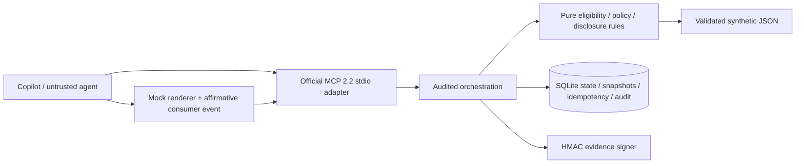
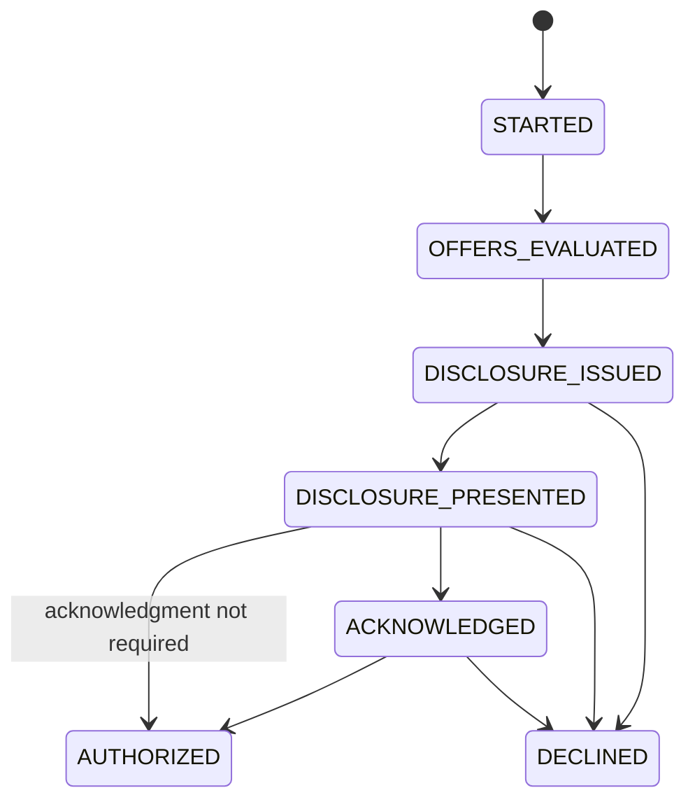

# Architecture

Intended production positioning: “OfferProof deterministically enforces the exact policies and disclosure copy approved by Synchrony Legal and Compliance.” This build executes synthetic approvals and is not a legal decision-maker.

The model interprets intent and plans calls. Only deterministic code computes eligible subtotals, resolves configured jurisdiction profiles, chooses protected templates, computes schedules, validates evidence and authorizes. The adapter exposes exactly five tools. Its public `MCPServer.list_tools` and `call_tool` overrides preserve the exact discovery schemas and let application validation occur **after** the audit attempt. The SDK owns protocol framing, discovery and transport.

## State and transactions

Presentation failure leaves state/version unchanged. Decline and expiry close the journey. Stale cart/context/offer invalidates downstream evidence and requires new evaluation; terms/policy/disclosure/renderer changes return it to preparation where resolvable. A malformed/unknown registry blocks processing. Already authorized journeys retain their historical decision; a new-key replay is blocked. Same-key retries return the original historical response and never reauthorize.

`BEGIN IMMEDIATE` serializes SQLite writers. Identity and expected version are checked while holding that transaction. The unique `(merchant, agent, idempotency key)` binds a semantic payload digest including tool name and all inputs except request/correlation IDs. A changed payload conflicts even if the key was originally used for a blocked request. Retrying a corrected payload requires a new key.

Each invocation first commits an `ATTEMPTED` event. Its final result, state, snapshot and idempotency result commit together. Failure to persist audit causes `AUDIT_UNAVAILABLE`, with sanitized stderr diagnostics. A process kill between attempt and outcome leaves a reconcilable unfinished attempt; a kill before the first write cannot be logged by that process. Protocol-invalid JSON rejected before tool dispatch is outside application tool-invocation auditing.

Tables: `journeys` stores current state; `idempotency` stores original semantic responses; `disclosure_snapshots` preserves exact issued text, inputs and digests after invalidation; `audit` is append-oriented with update/delete triggers and a SHA-256 chain. This is local tamper evidence, not immunity to a privileged database administrator. Retention and external reconciliation are production decisions.

## Trust boundaries

| Input | Control |
|---|---|
| Product prose | Never classified or executed; removed from stored cart |
| Structured line attributes | Synthetic SKU registry cross-check, exact integer math |
| Agent arguments | Bounded strict schemas; forbidden sensitive fields; no eval, code execution or supplied paths |
| Policy files | Fixed paths, duplicate-key rejection, strict schemas, checksums, maker/checker, validity windows, references and family wording checks |
| Jurisdiction context | Match full approved mock profile, merchant/program/channel and date; never derive law from billing state |
| Presentation | Exact digest, required section/order/prominence/accessibility lists, locale/channel, timestamp window, visibility duration, renderer version |
| Acknowledgment | Separate consumer affirmative event after verified mock presentation |
| Receipt | Constant-time HMAC; identity, versions, all relevant record digests, cart, context, allocation and expiry bindings |
| Database | Parameterized SQL, transaction boundaries, writable repository runtime only |

Signing key generation uses secure random bytes, exclusive creation and file flush. Filesystem permissions inherit local account controls on Windows; KMS-backed key custody is not implemented. Receipt resources are local single-tenant evidence retrieval by opaque ID, not authorization. They need authenticated tenant scopes before remote exposure.

## Transport and production roadmap

stdio fits the local demo because VS Code launches and owns the process. No application output is written to stdout. `run_mcp.py` resolves source/vendor paths relative to itself and processes the trusted Windows dependency bootstrap. Tool state is in SQLite, not MCP session memory. Server supports the protocol eras actually implemented by official SDK 2.2.

Production would use authenticated **Streamable HTTP**, enterprise identity/OAuth and scoped authorization; tenant isolation; KMS/HSM signing, rotation and revocation; authoritative offer/account/policy services; certified renderer and stronger presentation/consent evidence; external append-only event storage; SLOs/observability, retention, privacy and incident response; maker-checker publishing; legal, language and accessibility certification. Servicing and payment allocation remain a separate bounded system. None is represented as implemented here.
